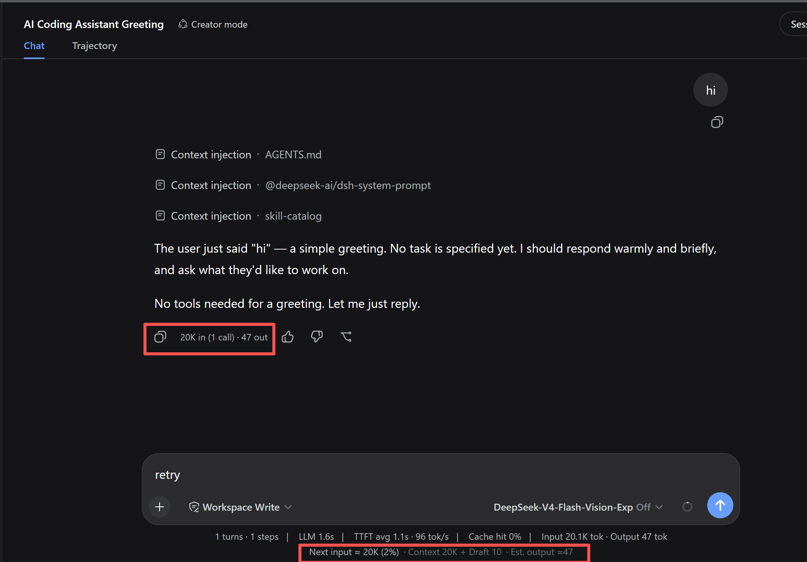
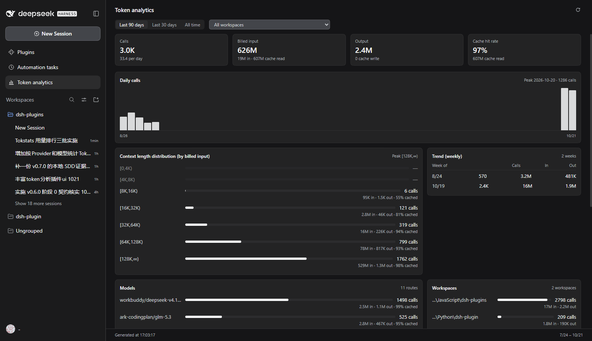

# dsh-tokstats

[简体中文](./README.md) | English

A repository of possibly useful [DeepSeek Harness (DSH)](https://github.com/deepseek-ai/deepseek-harness) plugins.

All plugins live in a single pack (one repo = one profile bundle): install once and they are all in — no per-plugin install.

## Plugins

| Plugin      | Function                                                                                          |
| ----------- | ------------------------------------------------------------------------------------------------- |
| **tokprev** | Three-part preview below the Composer: next input · draft · est. output (only the draft increment the official ContextMeter cannot show) |
| **tokstats** | "Token analytics" full panel in the sidebar: metric cards + daily calls + context-length distribution + weekly trend + model ranking + workspace ranking + promptopt usage, with 7-day / this-month / 30-day / all-time windows |
| **promptopt** | Star-icon button in the composer's tool row (hover for the tooltip): restructure the draft faithfully into structured input, compare original vs. restructured, and **adopt** it into the input only if you like it |

> **tokprev** is a pure interface plugin; **tokstats** and **promptopt** also ship a host-side half (one registers a session projection unit and aggregates, the other makes a single side-channel model call).

## Language (Chinese / English)

Plugins render their copy through the host locale service and **follow DSH Settings → General → Language**; the pack itself has no language switch.

- Dictionaries are namespaced per plugin — `dsh-tokstats.tokprev`, `dsh-tokstats.tokstats` and `dsh-tokstats.promptopt`.
- promptopt splits **two axes**: UI copy follows the host language, while the **restructured prompt follows the draft's language** (a Chinese draft still comes back Chinese on an English UI) — the result is content, not UI copy.
- With no explicit choice the host falls back to the browser language, and to en when it is neither zh nor en.
- `locale` is a **hard dependency** (as in official UI packs): when the host has no locale service (or it is disabled by hand), the whole bundle does not load — the UI disappears with no log line, rather than showing half-translated copy.
- Number notation (1.2K / 3.4M) and context bucket ranges (`[0,8K)`) are not translated; the panel footer clock is fixed 24-hour, independent of the browser locale.

## tokprev

Tells you roughly how many tokens the next turn will feed in. It **only fills the gap the host leaves**: the official ContextMeter already shows the absolute context figure with its system/tools/messages breakdown, and TurnUsagePanel already reports each turn's actual usage. What no official surface gives you is the draft, and the next-input total that includes it.



### Shape (below the Composer, three parts)

> **Next input ≈ 36.2K** · draft 0.3K · est. output 1.5K–3K

- **Next input** = the context anchor (`contextPressure.projectedTokens`) plus the draft estimate — updates live as you type;
- **Draft** = a local heuristic estimate (characters / 4 plus overhead); no request is made;
- **Output estimate** = the [P25, P75] range of the last 5 turns' actual `outputTokens`; `-` with no history, `≈value` with exactly one turn;
- Fallback: with no anchor the figure is prefixed with `*` (heuristic only); while the session is running the whole line hides (nothing to predict), and reappears when idle.

## tokstats

Cross-session token statistics: the host folds tokens within one session only; this plugin answers "how much of my usage sits in long contexts" and "is this week heavier than last".



"Token analytics" in the sidebar list opens a **full panel**, in four bands top to bottom (the daily chart and each pair of side-by-side cards take one band). Every block answers a specific question rather than dumping numbers:

| Block | The question it answers | How to read it |
| --- | --- | --- |
| **Metric cards** (four) | How much did this window use in total? How much did caching save? | calls (with the per-day rate for the window), input (split into uncached / cache read), output (with cache write), and cache-hit rate — scale and cache quality at a glance |
| **Daily calls** (a full-width bar chart) | Which day was heavy? Where is the peak? | it decides per window whether to draw each day or merge days into columns (per-day within 60 days), and bar height uses a square-root scale — real daily volumes differ by up to 100×, and on a linear scale everything but the peak collapses into a hairline; the peak date and count sit in the card's top-right corner and exact numbers are in the hover tooltips |
| **Context length distribution** | How long are my requests? How much of the usage sits in long contexts? | billed input binned into the six tiers the market actually bills by input length — `[0,8K)` / `[8K,32K)` / `[32K,128K)` / `[128K,256K)` / `[256K,512K)` / `[512K,∞)`; the boundaries line up with Alibaba Cloud / Volcano Engine / Zhipu's input-length tiers (32K / 128K / 256K) and MiniMax's 512K cut, while 4K / 8K / 16K are tiers no vendor sets. The top bucket is `[512K,∞)` rather than a further 1M cut, because 1M is already the largest context window any model offers — a single request's prompt cannot exceed it, so that cell would always be empty. Each row is label + share bar + call count, with the detail (in / out / cached) on a second line, and the peak bucket in the card corner |
| **Trend (weekly)** | Is this week heavier than last? | calls / input / output as four columns grouped by natural week (Monday-based); weekly totals always add up to the grand total (the weekly view is folded from the daily series — a single source of truth, so the two can never drift apart) |
| **Models** | Which model carries the usage? | a usage-share ranking by `provider/model` pair, sitting next to the workspace card. Each row is label + share bar + call count + `in · out · cached`; the same model under two providers takes two rows (that is the composite-key definition, not duplication); samples with no route land in an **Unattributed** row placed last, so the rows always add up to the grand total. **No cost accounting**: no amounts, no price table, no "no price configured" |
| **Workspaces** | Which project carries the usage? | ranked by call count with share bars, labelled by the last two path segments (the full path is in the tooltip); a picker switches to a single workspace (subagent usage merges up the parent chain into the root workspace; fork seed prefixes are deduplicated, never double-counted) |
| **Prompt restructure usage** | Is promptopt actually used — how often, and at what adoption rate? | promptopt's started / adopted / dismissed counts, adoption rate, and the character delta on adoption (the card is hidden when promptopt is not enabled) |

> The context-distribution chart is an **observation surface, not a price list**: models such as OpenAI, Anthropic, DeepSeek, Kimi, Tencent Hunyuan Hy3, GLM-5.2/5.3 and qwen-max have no length-based tiering, so for them landing in `[128K,256K)` only says how long the request was — it does **not** mean a surcharge was applied.

Narrow windows (main area under 900px) collapse to a single column; the refresh button in the top-right corner re-fetches even when the window and workspace are unchanged.

Same accounting as the host: billed input = `inputTokens + cacheReadTokens + cacheWriteTokens`; the final `assistant/message.usage` of a `(turn, step)` replaces its usage-chunk sample (no double counting).

Route accounting: the ranking key comes from `assistant/message`'s `message.source.{provider,model}`, the same field the host's token metering settles on. It deliberately **does not read the request-side configuration snapshot** — that records who the request *intended* to use, while this records who actually *billed*, and mixing the two makes the numbers impossible to reconcile. The price is that the rare step with only streaming usage and no final message (0.18% measured) has no route and lands in "Unattributed"; those steps still count as calls, and they are the only gap between the ranking's row sum and the grand total.

Four time windows — last 7 days, this month, last 30 days, all time (last 7 days by default). "This month" runs from the 1st of the current month through today and advances with the date. Data is fetched when the panel opens, when you change the window or workspace, and when you hit refresh; there is no resident push, because this panel does not need to tick.

Right after the first install the panel shows "Scanning…"; missing host-side services show an explanatory note instead of an error. **This plugin writes no files of its own**: the fold state is persisted by the official session projection cache, so deleting the old `storages/tokstats-checkpoint.json` from a previous version changes nothing.

## promptopt

Restructures a spoken-style draft into input that is easier for a model to parse — faithfully. It does not expand your draft into an execution plan, and it does not invent requirements. Hit the **star icon** in the tool row (hover for the tooltip, which changes to a reason when disabled), compare original against restructured, and **adopt** it only when you are happy.

- **Where it lives**: the right end of the composer card's **internal** tool row — between the model select and the send button, where your hand already is on the way to sending.
- **What restructuring does**: splits one run-on request carrying several asks into parallel items; resolves references like "that file" or "the error just now" back into the name the draft already uses; lifts constraint clauses (do not touch X, must use Y) out into explicit items; drops greetings, hedging and self-doubt. **It never adds facts, paths, constraints or steps the draft does not contain** — when it is unclear whether something was already there, the original wording stays.
- **Nothing to restructure**: when the draft is already structured enough the model returns it unchanged, the popover says so, and the adopt button is disabled.
- **Flow**: click (popover opens, spinner) → result arrives (original vs. restructured + elapsed time) → adopt or close. Closing, Esc, and clicking outside all count as cancel and abort the in-flight call.
- **Disabled** (greyed out, with a tooltip explaining why): the draft is empty, or it contains a reference chip, an image attachment, or a `/` command token — adopting is a full-text replacement, so a model reshuffle would break reference offsets and image ownership. That is silent corruption, so the button simply refuses.
- **Adopt semantics**: the snapshot taken when you clicked wins, and it is written back unconditionally. If you edited the draft while waiting, adopting overwrites those edits (no confirmation dialog).
- **Model and cost**: one **side-channel call** through the host's `ctx.llm`, riding the first registered provider/model route. **No configuration surface** and no API key of its own.
- **No session log**: no session events, no log writes. This call is **not** counted by tokstats' token statistics (it never lands in the durable session log), but its started / adopted / dismissed **counts** are shown in the tokstats panel (official storage domain, survives a restart).
- **Degrades**: when the model service is absent, clicking shows "The model call failed — please try again" instead of a blank screen.

If the button does nothing or always errors after a DSH upgrade, check the host-contract list in the maintenance doc first.

## Supported dsh versions

| Host version | Status | How it is verified | Evidence |
| --- | --- | --- | --- |
| `0.2.1-rc.2` | **tested** | link-install, restart dsh web, reload the page and eyeball every plugin (tokprev preview line / every tokstats panel block / promptopt star button) | the PK-05 / PK-08 / PK-10 rows in `docs/INVARIANTS.md`; `node scripts/check-plugin-structure.js` |

The declaration lives in `package.json` as `engines.dsh`, and its value is an **exact version, not a
range**: the host evaluates compatibility from `engines.dsh` alone (the field suppresses
`peerDependencies` for that decision), and **skips the whole bundle** when it does not match — recording
it only in `skippedBundles` without printing anything. While the host is still in rc the vendor keeps the
right to break contracts, so this pin fails closed instead of waving unverified versions through.
`dsh.compatibility.dshReleases` describes the same fact (**no automated consumer — it is for humans
only**: a full-text scan of the host asar finds 0 hits for `dshReleases` across its 7026 `.js` entries;
the official `dsh-plugin-market` reads only `engines.dsh` from the registry, and the third-party
`dshmarket` has 0 hits as well).

**If the plugin UI vanishes after a dsh upgrade**, first check whether this pin blocked the whole bundle:
`node -e "console.log(require('./package.json').engines)"` against the host version. Once the checklist
below passes on the new host, raise the pin and update "开发所对版本" in `docs/MAINTAINING.md`. The
checklist matters because a drifted host contract shows up as a plugin that silently does nothing, never
as an error:

1. `node scripts/check-plugin-structure.js` → output contains `OK:` and zero `WARN` (PK-01 / PK-02 / PK-03 / PK-05 / PK-07 / PK-08 / PK-11 / PK-12 all live here);
2. `npm test` → 0 fail (projection-unit shape, RPC envelope, dictionary key sets, degradation matrix);
3. restart dsh web → reload → eyeball every plugin (only a human can do this step; the first two do not cover "the slot registered but nothing rendered").

## Installation (web profile)

Prerequisites: Node.js, git, pnpm (`npm i -g pnpm`). Private repos work too (pnpm uses your local git credentials).

> **Install from GitHub only — this pack is not published to any registry.** Note that the name
> `dsh-plugins` on npm belongs to **somebody else** (a plugin market CLI unrelated to this project).
> This pack was renamed to `dsh-tokstats` in v0.7.0; `add dsh-plugins` is still not this project.

```powershell
# Install from GitHub (other users)
npx @deepseek-ai/dsh plugin --profile web add github:PlusQi/dsh-tokstats

# Pin a version: # accepts a tag / branch / commit
npx @deepseek-ai/dsh plugin --profile web add github:PlusQi/dsh-tokstats#v0.7.0

# Local dev link (edit + restart to see changes; replace with your local repo path)
npx @deepseek-ai/dsh plugin --profile web add link:D:\path\to\dsh-tokstats
```

> **Upgrading from the old name** (the package name changed from `dsh-plugins` to `dsh-tokstats` in
> v0.7.0): the dependency key changed, so `update` with the old name fails — you must
> **remove, then add**:
>
> ```powershell
> npx @deepseek-ai/dsh plugin --profile web remove dsh-plugins
> npx @deepseek-ai/dsh plugin --profile web add github:PlusQi/dsh-tokstats
> ```
>
> The repository moved to `github.com/PlusQi/dsh-tokstats` — **the old address still works** (GitHub
> answers with a 301; verified). Published tags and the `raw.githubusercontent.com` image links in the
> READMEs keep working. **No projection cache is lost**: the projection unit key, RPC channel names and
> storage domains deliberately keep the old name (see the note at the end of the next section), so this
> rename does not trigger a cold fold.

After installing, **restart the dsh web process** and reload the page (profile composition only happens at startup).
Install location: `$DSH_HOME/profiles/web/` (default `~/.dsh`). `dsh plugin` is a pnpm forwarder:
after install it automatically attaches packages declaring `dsh.bundle` to the `dsh.profile.bundles` layer list — no manual config edits.
This pack has no build scripts, so git installs never trip pnpm's build-script gate (allowBuilds).

## Update / uninstall / toggling a single plugin

```powershell
# Update: re-resolves the install spec (unpinned refs pull the default branch's latest commit)
npx @deepseek-ai/dsh plugin --profile web update dsh-tokstats

# Uninstall the whole pack (auto-detached from the layer list)
npx @deepseek-ai/dsh plugin --profile web remove dsh-tokstats
```

To temporarily disable a single plugin (no code changes): append to `~/.dsh/profiles/web/cordis.patch.yml`

```yaml
- id: tokprev
  disabled: true
```

Restart to apply. Note: `disabled` removes that row's **host-side** fiber only — whether the browser-side UI unloads depends on **whether any row of the pack is still live**, so for a pure-interface plugin like tokprev, disabling one row does **not** make it disappear from the page. For a real per-plugin off-switch, split the plugin into its own package (rationale and steps in the maintenance doc).

> **Why some names can no longer be changed**: v0.7.0 renamed the package to `dsh-tokstats`, but the
> identifiers below **deliberately keep** the old `dsh-plugins` name — they are persisted state or
> cross-side contracts, not display names:
>
> | Identifier | Value | Why it is frozen |
> | --- | --- | --- |
> | Projection unit key | `dsh-plugins.tokstats` | Stored as a cache field name; changing it invalidates every user's cache rows and forces a full cold fold |
> | RPC channel names | `/dsh-plugins.tokstats` · `/dsh-plugins.promptopt` | Contract between the browser side and the host side |
> | Storage domains | `dsh_plugins_tokstats` · `dsh_plugins_promptopt` | Persisted; and the host's `UNIT_NAME_RE` forbids dots |
>
> The rule in one line: **persisted or cross-side ⇒ frozen; in-process or display-only ⇒ follows the
> package name**. That is why the UI dictionary namespaces and the style-tag prefix did become
> `dsh-tokstats.*`, while the three items above stay put.

## Maintenance

This file is for users. Maintainers and AI agents start from [AGENTS.md](./AGENTS.md) (routing table + hard rules + structural guard); the publishing flow, the four steps for adding a plugin, the four hard constraints of the multi-plugin structure, each plugin's host-side behavior and host contracts, and the real semantics of the per-plugin switch live in [docs/MAINTAINING.md](./docs/MAINTAINING.md). Release history: [CHANGELOG.md](./CHANGELOG.md).

## License

[MIT](./LICENSE)
