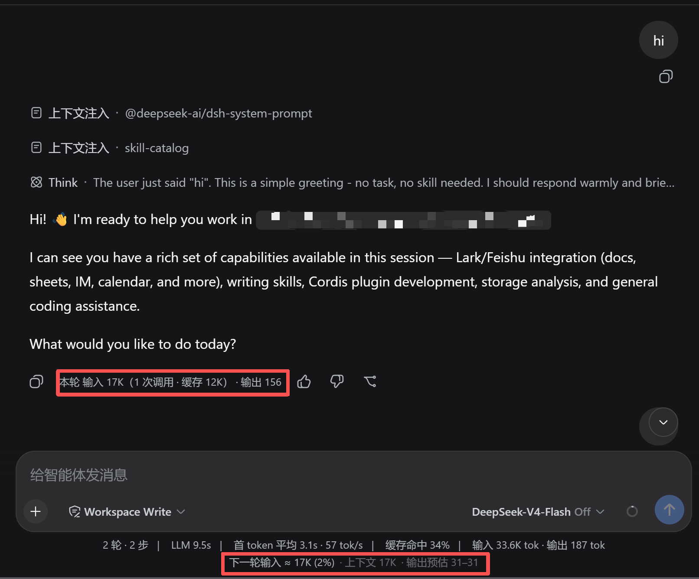
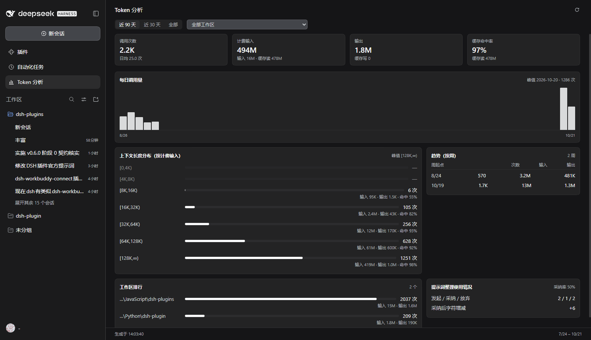

# dsh-tokstats

简体中文 | [English](./README.en.md)

可能有用的 [DeepSeek Harness (DSH)](https://github.com/deepseek-ai/deepseek-harness) 插件仓库。

所有插件集中在一个包里（一个 repo = 一个 profile bundle），装一次即全部生效，不必逐个安装。

## 插件清单

| 插件            | 功能                                                                                      |
| ------------- | --------------------------------------------------------------------------------------- |
| **tokprev**   | Composer 底部三点式预告：下一轮输入 · 草稿 · 输出预估（只补官方 ContextMeter 给不了的草稿增量） |
| **tokstats**  | 侧栏「Token 分析」全局面板：指标卡 + 每日调用量 + 上下文长度分布 + 周趋势 + 模型排行 + 工作区排行 + promptopt 使用计数，近 7 天／本月／近 30 天／全部四档 |
| **promptopt** | Composer 工具行的星标按钮（hover 看提示）：把草稿保真重排为结构化输入，原文／整理结果对照，**采纳**才写回输入框 |

> **tokprev** 是纯界面插件；**tokstats** 与 **promptopt** 另有宿主侧半边（一个注册会话投影单元并汇总，一个发起一次旁路模型调用）。

## 语言（中文 / English）

插件的界面文案都走宿主 locale 服务，**跟随 DSH 设置 → 常规 → Language**，插件自身没有语言开关。

- 词典按插件划分命名空间：`dsh-tokstats.tokprev`、`dsh-tokstats.tokstats` 与 `dsh-tokstats.promptopt`。
- promptopt 是**两轴分离**：界面文案跟随宿主语言，而**整理产物跟随草稿语言**（英文界面照样出中文整理结果）——产物是内容、不是 UI 文案，不进词典。
- 用户没显式选过时，宿主取浏览器语言；非 zh/en 回落 en。
- `locale` 是本包的**硬依赖**（与官方 UI 包一致）：宿主没有 locale 服务（或被手动禁用）时整包不加载——表现为插件 UI 消失且无日志，而不是半中半英。
- 数字记号（1.2K / 3.4M）、上下文桶区间（`[0,8K)`）不翻译（英文语境同样通用）；面板脚注时间固定 24 小时制，不跟浏览器 locale。

## tokprev 用途说明

发送前告诉你这一轮大概要喂多少 token。**只补官方没有的那部分**：官方 ContextMeter 已经给了上下文绝对数与系统/工具/消息三段明细，每轮真实消耗另有 TurnUsagePanel，所以本插件只保留官方结构上给不了的增量——草稿与下一轮输入合计。



### 形态（Composer 底部，三点式）

> **下一轮输入 ≈ 36.2K** · 草稿 0.3K · 输出预估 1.5K–3K

- **下一轮输入** = 上下文锚点（`contextPressure.projectedTokens`，提供商锚定）+ 草稿估算，随打字实时跳动；
- **草稿** = 本地启发式估算（字符数 / 4 + 开销），不发请求；
- **输出预估** = 最近 5 轮真实 `outputTokens` 的 \[P25, P75] 区间；无历史时显示 `-`，仅 1 轮时显示 `≈该值`；
- 降级：无真实请求锚点时数字加 `*` 前缀（纯启发式）；会话运行中整行隐藏（预测对象不存在），空闲恢复。

## tokstats 用途说明

跨会话 token 消耗统计：宿主只在单会话内折叠 token，本插件回答「长上下文请求占比多高」「这周比上周多还是少」。



侧栏列表里的「Token 分析」进入**全局面板**，自上而下分四段（每日图与两张并排卡各占一段）。每块都对着一个具体问题，不是「一堆数字」：

| 区块 | 解答的问题 | 怎么看 |
| --- | --- | --- |
| **顶部指标卡**（四张） | 这个窗口一共用了多少？缓存省了多少？ | 调用次数（附窗口内日均）、输入（附未缓存 / 缓存读拆分）、输出（附缓存写）、缓存命中率——一眼看规模与缓存质量 |
| **每日调用量**（整行柱状图） | 哪天用得多？峰值在哪天？ | 按窗口跨度自动决定逐日还是合并成列（60 天内逐日），柱高用**平方根刻度**——实测日量差异可达百倍，线性刻度下除峰值外全压成细线；峰值日期与次数标在卡片右上角，精确数字在悬停提示里 |
| **上下文长度分布** | 我的请求有多长？长上下文占多大比例？ | 计费输入按市面「按输入长度分档计费」的档位分 6 桶 `[0,8K)` / `[8K,32K)` / `[32K,128K)` / `[128K,256K)` / `[256K,512K)` / `[512K,∞)`——边界对齐阿里云 / 火山 / 智谱的输入长度档位（32K / 128K / 256K）与 MiniMax 的 512K 分界，4K / 8K / 16K 无厂商设档；最高桶是 `[512K,∞)` 而非再切一刀 1M，因为 1M 已是市面所有模型上下文窗口的最大值，单请求 prompt 超不过它，那一格永远为空。每行 = 标签 + 占比条 + 次数，明细（输入 / 输出 / 命中率）在第二行，卡片角上标峰值桶 |
| **趋势（按周）** | 这周比上周多还是少？ | 按自然周（周一起）分组的次数 / 输入 / 输出四列表；周合计之和恒等于总计（周趋势由每日序列归并，只有一趟真源，不会漂移） |
| **模型排行** | 用量集中在哪个模型上？ | 按 `provider/model` 组合的用量占比排行，与工作区卡并排。每行 = 标签 + 占比条 + 次数 + `输入 · 输出 · 命中率`；同名模型挂在两个 provider 下各占一行（组合键口径，不去重）；拿不到路由的样本归「未标注」并排最后，保证各行之和恒等于总计。**不做成本核算**：没有金额、没有价表、没有「未配价」 |
| **工作区排行** | 用量集中在哪个项目上？ | 按调用次数排序并带占比条，标签取路径末两段（完整路径在悬停提示里）；下拉可切到单个工作区（子会话沿 parent 链归并到根工作区，fork 的 seed 前缀去重不双计） |
| **提示词整理使用情况** | promptopt 真的被用上了吗？用了几次、采纳率多少？ | promptopt 的发起 / 采纳 / 放弃计数、采纳率与采纳后的字符增减（promptopt 未启用时该卡片不显示） |

> 上下文分布那张图是**观测面，不是价目表**：OpenAI、Anthropic、DeepSeek、Kimi、腾讯混元 Hy3、GLM-5.2/5.3、qwen-max 等模型没有按长度分档的计价，对它们「落进 `[128K,256K)`」只说明请求有多长，**不代表被加价**。

窄窗口（主区宽度 900px 以下）自动折成单列；右上角的刷新按钮在窗口与工作区不变时也能重新拉一次数。

口径与宿主一致：计费输入 = `inputTokens + cacheReadTokens + cacheWriteTokens`；同 `(turn,step)` 的最终 `assistant/message.usage` 替换 usage chunk 采样（不双计）。

路由口径：排行键取自 `assistant/message` 的 `message.source.{provider,model}`，与宿主 token 计量同源。**不读请求侧的配置快照**——那是「请求时打算用谁」，与「实际结算了谁」不同源，混用会让数字无法对账。代价是极少数只有流式 usage、没有 message 终值的步（实测 0.18%）拿不到路由，归「未标注」；它们仍计入调用次数，是排行各行之和与总计之间唯一的差额出口。同一模型挂在多个 provider 下会分成多行，这是组合键的定义而非重复。

时间窗有「近 7 天 / 本月 / 近 30 天 / 全部」四档（默认近 7 天）；「本月」是当月 1 日到今天，随日期自动推进。数据在打开面板、切换窗口、切换工作区、点刷新时各拉一次，不做常驻推送——这个面板不需要实时跳动。

首次安装后面板显示「统计中…」；宿主侧服务缺席时显示对应提示，不会报错。**本插件不写任何自有文件**：折叠状态由 DSH 官方的会话投影缓存持久化，删掉旧版遗留的 `storages/tokstats-checkpoint.json` 不影响使用。

## promptopt 用途说明

把口语草稿**保真重排**成模型更易解析的结构化输入——不是把它扩写成执行计划，更不是替你想需求。点工具行里的**星标按钮**（hover 看提示，禁用时换文字），原文与整理结果上下对照，**满意才点采纳**。

- **触发位置**：composer 卡片**内部**工具行的右端（模型选择座位之后、发送按钮之前）——「发送前顺手点」的位置。
- **重排做什么**：一段话里的多个诉求拆成并列条目；把「那个文件」「刚才的报错」这类指代还原为草稿里已有的名词；把「不要动 X」「必须用 Y」这类约束从句提成显式条目；去掉寒暄、试探、自我怀疑。**草稿里没有的事实、路径、约束、步骤一律不补**——不确定是否原文已有，就保留原样。
- **无需整理**：草稿已经足够结构化时模型原样返回，弹层显示「原文已足够清晰，无需整理」并禁用采纳按钮。
- **流程**：点按钮（弹层出现、转圈）→ 模型返回（上下对照 + 耗时脚注）→ 采纳 / 关闭。关闭、Esc、点弹层外都算取消，会中止这次调用。
- **禁用场景**（按钮置灰，悬浮有说明）：草稿为空；草稿含引用 chip、图片附件或 `/` 命令 token——写回是全量替换，模型重排会破坏引用坐标与图片归属，属于静默损坏，直接不让点。
- **采纳语义**：以**发起时刻的草稿快照**为准，无条件写回。等待期间你又改了草稿，采纳会覆盖掉那些改动（没有二次确认弹层）。
- **模型与开销**：走宿主 `ctx.llm` 做一次**旁路调用**——骑当前已注册的第一个 provider/model 路由，**没有配置面**，也不新建 API key。
- **不写会话日志**：无会话事件、无日志写入。这次旁路调用的开销**不会**计入 tokstats 的 token 统计（它不在 durable 会话日志里），但发起/采纳/放弃的**次数**会记在 tokstats 面板里（官方存储域，跨重启可查）。
- **降级**：模型服务缺席时点按钮显示「模型调用失败，请稍后重试」，不会白屏。

DSH 升级后若按钮点了没反应或一直报错，先对照维护文档里的宿主契约清单。

## 支持的 dsh 版本

| 宿主版本 | 状态 | 怎么验证 | 证据 |
| --- | --- | --- | --- |
| `0.2.1-rc.3` | **实测通过** | link 安装后重启 dsh web、刷新页面，逐个插件目检（tokprev 预告行 / tokstats 面板各区块 / promptopt 星标按钮） | `docs/INVARIANTS.md` 的 PK-05 / PK-08 / PK-10 / PK-15；`node scripts/check-plugin-structure.js` |
| `0.2.1-rc.2` | 今已不再放行 | 与上一行为同一代码路径；v0.7.0 的 pin 曾是它，宿主升到 rc.3 后整包被跳过（详见下方自查） | 历史实测记录（v0.7.0 发布时） |

声明方式是 `package.json` 的 `engines.dsh`，值是**精确版本而非区间**——宿主启动时按
`engines.dsh` 单独判定兼容性（有该字段时忽略 `peerDependencies`），**不满足就整包跳过**，
且只记进 `skippedBundles` 不打印。rc 阶段官方保留破坏权，所以这里宁可失败关闭，也不写一条
没实测过的区间去「放行」未知版本。`dsh.compatibility.dshReleases` 是同一事实的描述性元数据
（**无任何自动化消费方，仅人读**——实测宿主 asar（rc.3）内 7131 个 `.js` 条目全文扫 `dshReleases`
**0 命中**，官方 `dsh-plugin-market` 只从 registry 读 `engines.dsh`，第三方 `dshmarket` 同样 0 命中）；
两个字段的一致性由 guard 的 **PK-15** 静态兜住，抬 pin 忘同步 `dshReleases` 会被拦下。

**升级 dsh 后插件 UI 消失**，先查是不是这个 pin 把整包挡掉了：`node -e "console.log(require('./package.json').engines)"`
对照宿主版本；确认新版宿主上把下面的清单重验一遍，再抬 pin 并同步 `docs/MAINTAINING.md`「开发所对版本」。
重验清单（宿主契约一旦漂移，表现是插件静默不工作而不是报错）：

1. `node scripts/check-plugin-structure.js` → 输出含 `OK:` 且零 `WARN`（PK-01 / PK-02 / PK-03 / PK-05 / PK-07 / PK-08 / PK-11 / PK-12 全在这里）；
2. `npm test` → 0 fail（投影单元形状、RPC 信封、词典键集、降级矩阵）；
3. 重启 dsh web → 刷新 → 逐个插件目检（这一步只有人能做，前两步都不覆盖「slot 注册了但界面没渲染」）。

## 安装（web profile）

前置：Node.js、git、pnpm（`npm i -g pnpm`）。私有仓库也可安装（pnpm 走你本机 git 凭据）。

> **只能从 GitHub 装，本包没有在任何 registry 上发布。** 注意 `dsh-plugins` 这个名字在 npm 上
> 属于**别人**（一个插件市场 CLI，与本项目无关）——本包自 v0.7.0 起已改名为 `dsh-tokstats`，
> 但避免误会仍要说明：**不要 `add dsh-plugins`，那不是本项目。**

```powershell
# 从 GitHub 安装（其他用户）
npx @deepseek-ai/dsh plugin --profile web add github:PlusQi/dsh-tokstats

# 固定版本：# 后可跟 tag / 分支 / commit
npx @deepseek-ai/dsh plugin --profile web add github:PlusQi/dsh-tokstats#v0.7.0

# 本机开发链接（改代码重启即生效，路径换成你本地的仓库位置）
npx @deepseek-ai/dsh plugin --profile web add link:D:\path\to\dsh-tokstats
```

> **从旧名升级（v0.7.0 起包名由 `dsh-plugins` 改为 `dsh-tokstats`）**：依赖键变了，必须**先 remove 再 add**：
>
> ```powershell
> npx @deepseek-ai/dsh plugin --profile web remove dsh-plugins
> npx @deepseek-ai/dsh plugin --profile web add github:PlusQi/dsh-tokstats
> ```
>
> ⚠️ **不迁移会怎样**：`update dsh-plugins` 用旧名会失效；更糟的是**插件 UI 会静默消失**——
> pnpm 容忍「依赖键 `dsh-plugins` 指向包名 `dsh-tokstats`」这种不匹配（`pnpm install` 不报错，
> 显示成 `dsh-plugins <- dsh-tokstats 0.7.0`），但宿主 `client-modules` 会拿依赖键当期望包名去
> 校验 manifest 的 `name`，不相等就**该行不进入 client 图**：界面整块不见、宿主日志里没有错误。
> 本机实测确认了这个判定链，所以这一节给的顺序是「先 remove」而不是「直接 update」。
>
> 仓库地址同步改为 `github.com/PlusQi/dsh-tokstats`——**旧地址仍可用**（GitHub 301 自动重定向，
> 已实测），已发布 tag 与 README 里指向 `raw.githubusercontent.com` 的图片都不受影响。
> **投影缓存不会丢**：投影单元 key、RPC 通道名与存储域名都刻意保留旧名（见下节末说明），
> 所以这次改名不需要冷折叠。

安装后**重启 dsh web 进程**并刷新页面（profile 组合仅启动时生效）。
安装位置：`$DSH_HOME/profiles/web/`（默认 `~/.dsh`）。`dsh plugin` 是 pnpm 转发器：
装完后自动把声明了 `dsh.bundle` 的包挂进 `dsh.profile.bundles` 层列表，无需手改配置。
本包无构建脚本，git 安装不会触发 pnpm 的 build-script 拦截（allowBuilds）。

## 更新 / 卸载 / 单插件开关

```powershell
# 更新：重新解析安装 spec（未固定 ref 则拉默认分支最新提交）
npx @deepseek-ai/dsh plugin --profile web update dsh-tokstats

# 整包卸载（自动从层列表摘除）
npx @deepseek-ai/dsh plugin --profile web remove dsh-tokstats
```

临时关掉单个插件（不动代码）：编辑 `~/.dsh/profiles/web/cordis.patch.yml` 追加

```yaml
- id: tokprev
  disabled: true
```

重启生效。注意：`disabled` 只摘除该行的**宿主侧** fiber，浏览器侧界面是否卸载取决于**包内是否还有任一行存活**——所以对纯界面插件（如 tokprev）禁用一行**不会**让它从页面上消失。需要按插件独立开关，请把该插件拆成独立包（原因与步骤见维护文档）。

> **为什么有些名字已经改不动了**：v0.7.0 把包名改成 `dsh-tokstats`，但下面这些标识**刻意保留**旧名 `dsh-plugins`——它们是持久化或跨侧契约，不是展示名：
>
> | 标识 | 值 | 为什么不能改 |
> | --- | --- | --- |
> | 投影单元 key | `dsh-plugins.tokstats` | 进缓存字段名；改了等于让每个用户的全部缓存行作废、重付一次全量冷折叠 |
> | RPC 通道名 | `/dsh-plugins.tokstats` · `/dsh-plugins.promptopt` | 浏览器侧与宿主侧两边的契约 |
> | 存储域名 | `dsh_plugins_tokstats` · `dsh_plugins_promptopt` | 持久化；且宿主 `UNIT_NAME_RE` 不允许点号 |
>
> 判据一句话：**有持久化或跨侧契约 ⇒ 冻结；纯进程内/纯展示 ⇒ 跟着包名走**。所以界面文案的词典命名空间、样式 tag 前缀这些已经改成 `dsh-tokstats.*`，而上面三类别动。

## 维护

本文件面向使用者。维护者与 AI Agent 从 [AGENTS.md](./AGENTS.md) 进入（路由表 + 硬规则 + 结构 guard）；发布流程、新增插件五步、多插件结构的四条硬约束、各插件的 host 侧行为与宿主契约、单插件开关的真实语义见 [docs/MAINTAINING.md](./docs/MAINTAINING.md)。版本变更记录见 [CHANGELOG.md](./CHANGELOG.md)。

## License

[MIT](./LICENSE)
